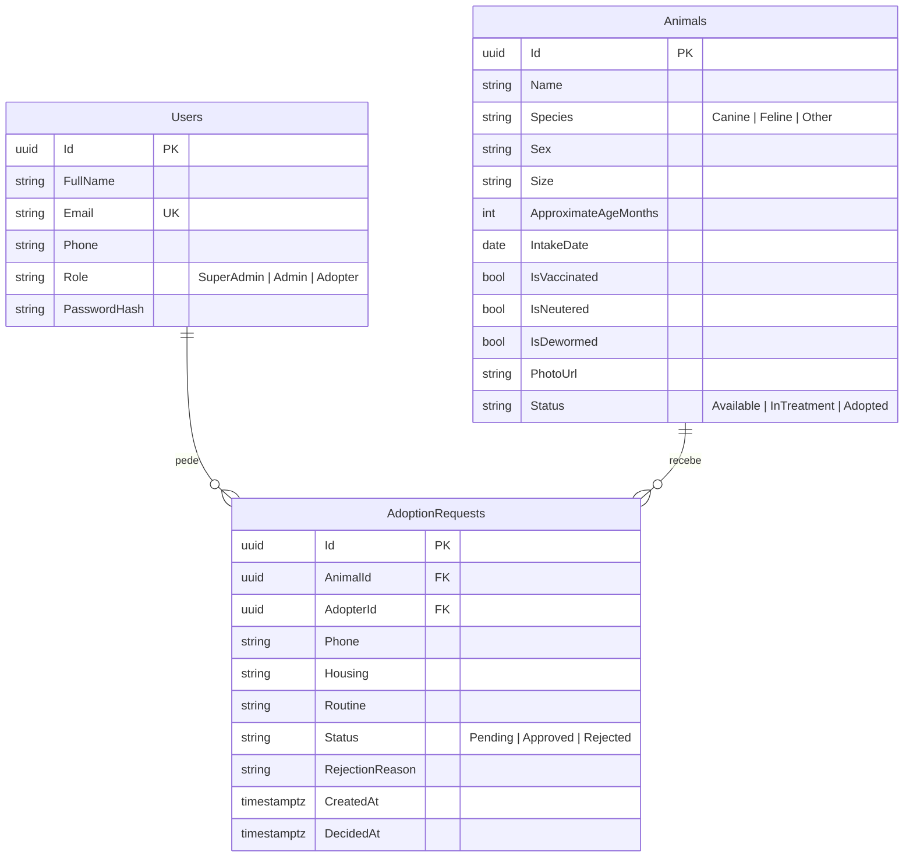
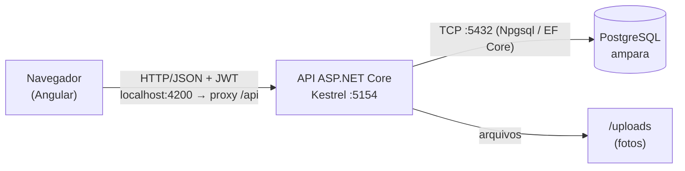

# Ampara · API

Backend do **Ampara**, sistema para a ONG de proteção animal **Patas do Bem**. A equipe cadastra os animais acolhidos, o público vê no site quem está disponível, o adotante pede a adoção pela internet e a ONG aprova ou recusa. Os dados registrados viram os indicadores do painel.

Stack: **.NET 10 (ASP.NET Core)**, **EF Core 10 + PostgreSQL**, JWT e xUnit.

## Como rodar

Pré-requisitos: [.NET 10 SDK](https://dotnet.microsoft.com/download/dotnet/10.0) e [PostgreSQL](https://www.postgresql.org/download/) 16+ em `localhost:5432`.

```bash
# 1. Ferramentas do repositório (dotnet-ef)
dotnet tool restore

# 2. Segredos locais (ficam fora do git). Use aspas simples se a senha tiver $ ou !
dotnet user-secrets set "ConnectionStrings:Default" 'Host=localhost;Port=5432;Database=ampara;Username=postgres;Password=SUA_SENHA' --project src/Ampara
dotnet user-secrets set "Jwt:Key" 'uma-chave-aleatoria-com-pelo-menos-32-caracteres' --project src/Ampara

# 3. Subir a API
dotnet run --project src/Ampara --launch-profile http
```

Em desenvolvimento, a API cria o banco, aplica a migration e insere dados de demonstração ao iniciar. O Swagger fica em http://localhost:5154/swagger (botão *Authorize* para colar o token).

### Usuários de demonstração

Senha dos dois: `Ampara@2026` (só no ambiente de desenvolvimento, em `appsettings.Development.json`).

| E-mail | Papel |
|---|---|
| `admin@ampara.local` | SuperAdmin (responsável pela ONG) |
| `adotante@ampara.local` | Adopter |

### Papéis

| Papel | Quem é | Pode |
|---|---|---|
| **SuperAdmin** | o responsável pela ONG, criado pelo seed (só existe um) | tudo o que o Admin faz e gerenciar a equipe |
| **Admin** | alguém que o SuperAdmin promoveu | cadastrar animais, aprovar ou recusar adoções e ver o painel |
| **Adopter** | qualquer pessoa que se cadastra | pedir adoção e acompanhar as próprias solicitações |

Todo cadastro novo (`POST /api/auth/register`) entra como adotante. Só o SuperAdmin promove alguém a Admin ou o devolve a adotante. Ninguém vira SuperAdmin por essa via, e o papel do SuperAdmin não pode ser alterado.

## Banco de dados

Três tabelas:



As senhas são guardadas com hash PBKDF2, e os enums como texto para facilitar a leitura direto no banco.

## Fluxo de adoção

```
Pending ──(ONG aprova)──► Approved   → o animal passa para Adopted e sai do catálogo
   └─────(ONG recusa com motivo)──► Rejected   → o animal continua disponível
```

- Só animais `Available` aparecem no catálogo e podem receber pedido.
- Um adotante não pode ter dois pedidos em análise para o mesmo animal.
- Se dois adotantes pedirem o mesmo animal, a ONG aprova um e recusa o outro (aprovar o segundo é bloqueado).

## Indicadores (painel da ONG)

`GET /api/dashboard` calcula, a partir dos dados gravados:

- total de animais, disponíveis, em tratamento e adotados;
- solicitações aguardando análise;
- **acolhimentos × adoções por mês nos últimos 6 meses** (gráfico do painel).

## Mapa da API

Todas as rotas começam em `/api`. Enums trafegam como texto e os erros seguem o ProblemDetails (RFC 7807): `400` dados inválidos, `401` sem login, `403` sem permissão, `404` inexistente, `409` conflito, `422` regra de negócio violada. A mensagem em `detail` pode ser mostrada ao usuário.

| Área | Rotas | Quem |
|---|---|---|
| Autenticação | `POST auth/register` · `POST auth/login` · `GET auth/me` | público · logado |
| Catálogo público | `GET public/animals?species` · `GET public/animals/{id}` | qualquer pessoa |
| Animais | `GET animals?search&species&status&page&pageSize` · `GET animals/{id}` · `POST animals` · `PUT animals/{id}` · `POST animals/{id}/photo` (multipart `file`, JPG/PNG até 5 MB) | equipe (Admin e SuperAdmin) |
| Adoções | `POST adoptions` · `GET adoptions/mine` | adotante |
| | `GET adoptions?status&page&pageSize` · `POST adoptions/{id}/approve` · `POST adoptions/{id}/reject` | equipe |
| | `GET adoptions/{id}` | equipe ou o adotante dono |
| Painel | `GET dashboard` | equipe |
| Equipe | `GET users?search&page&pageSize` · `PUT users/{id}/role` (`{ "role": "Admin" }` ou `"Adopter"`) | SuperAdmin |

O login devolve um `accessToken` (JWT válido por 8 horas). Envie-o em `Authorization: Bearer <token>`.

## Comunicação e rede



- O front fala com a API por **REST (HTTP + JSON)**. O token JWT vai no cabeçalho de cada requisição.
- A API libera o front no **CORS** (`Cors:AllowedOrigins`) e serve as fotos em `/uploads`.
- A API acessa o PostgreSQL por **TCP na porta 5432**. O banco não fica exposto ao navegador.
- Em produção, a mesma divisão roda atrás de HTTPS (a API já redireciona HTTP → HTTPS fora do ambiente de desenvolvimento).

## Testes

```bash
dotnet test
```

São 64 testes unitários em `tests/Ampara.UnitTests`, que não precisam de banco:

- regras de domínio (animal, adoção, usuário);
- casos de uso (autenticação, animais, adoções, painel, equipe);
- JWT e hash de senha;
- tratamento de erros.

## Estrutura

Projeto único em camadas (Clean Architecture + DDD simplificado). As dependências apontam para dentro: `Api → Application → Domain`, com `Infrastructure` implementando as interfaces.

```
src/Ampara/
├── Domain/           # entidades e regras (User, Animal, AdoptionRequest), contratos dos repositórios e Enums/
├── Application/      # casos de uso (services) e contratos (DTOs) por feature
├── Infrastructure/   # EF Core/PostgreSQL (repositórios, migration, seed), JWT, hash de senha, fotos
├── Api/              # controllers, tratamento de erros, usuário atual
└── Program.cs
tests/Ampara.UnitTests/
```

## Convenções

- Commits no padrão [Conventional Commits](https://www.conventionalcommits.org/), em inglês e sem escopo: `feat: add animal registration`.
- Código (identificadores, rotas, arquivos) em inglês; mensagens exibidas ao usuário em pt-BR.
- Enums em `Domain/Enums/`, um por arquivo e com o sufixo `Enum` (`AnimalStatusEnum`). Os valores trafegam e são gravados como texto (`"Available"`).
- Fotos enviadas ficam em `src/Ampara/uploads/` (fora do git).
