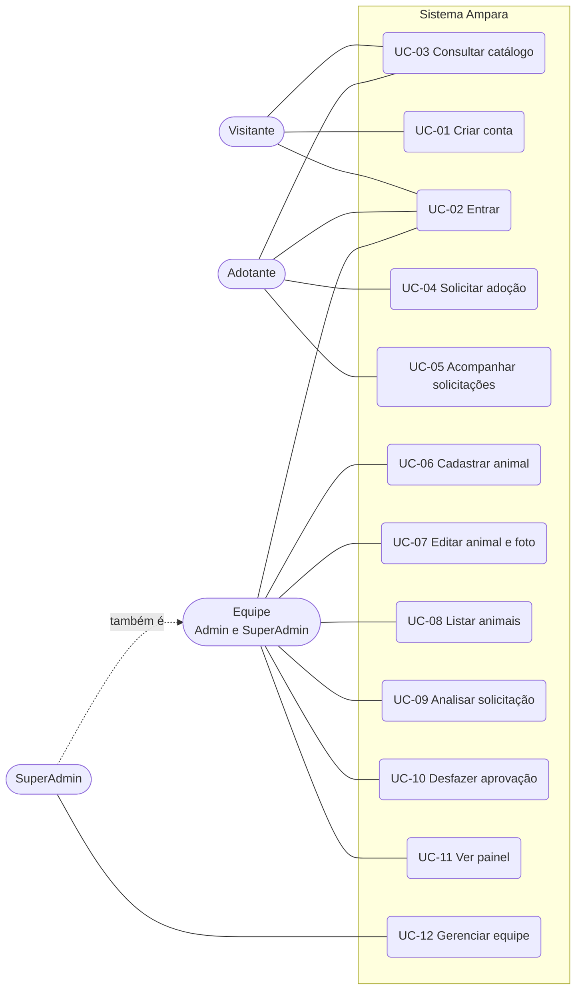

# 3. Casos de uso e histórias de usuário

## 3.1. Diagrama de casos de uso

> O SuperAdmin faz tudo o que a equipe faz, e ainda gerencia a equipe (UC-12).

## 3.2. Lista de casos de uso

| ID | Caso de uso | Ator | Requisitos | Situação |
|---|---|---|---|---|
| UC-01 | Criar conta | Visitante | RF-01 | ✅ |
| UC-02 | Entrar | Todos | RF-02, RF-03 | ✅ |
| UC-03 | Consultar catálogo de animais | Visitante, Adotante | RF-13 | ✅ |
| UC-04 | Solicitar adoção | Adotante | RF-14 | ✅ |
| UC-05 | Acompanhar as próprias solicitações | Adotante | RF-15 | ✅ |
| UC-06 | Cadastrar animal | Equipe | RF-07, RF-08, RF-10 | ✅ |
| UC-07 | Editar animal e trocar a foto | Equipe | RF-07, RF-08 | ✅ |
| UC-08 | Listar e filtrar animais | Equipe | RF-09 | ✅ |
| UC-09 | Analisar solicitação (aprovar ou recusar) | Equipe | RF-16 | ✅ |
| UC-10 | Desfazer uma aprovação | Equipe | RF-16 | ✅ |
| UC-11 | Ver o painel de indicadores | Equipe | RF-18 | ✅ |
| UC-12 | Gerenciar a equipe (promover e rebaixar) | SuperAdmin | RF-04 | ✅ |

## 3.3. Descrição dos casos de uso principais

### UC-04 — Solicitar adoção

| | |
|---|---|
| **Ator** | Adotante (logado) |
| **Pré-condição** | O animal está *Disponível*. |
| **Pós-condição** | Existe uma solicitação *Pendente* ligada ao adotante e ao animal. |

**Fluxo principal**

1. O adotante abre a ficha de um animal e escolhe "Quero adotar".
2. O sistema mostra o formulário com os dados do animal.
3. O adotante informa telefone, moradia, rotina e mensagem, e aceita os termos.
4. O sistema valida os dados e cria a solicitação como *Pendente*.
5. O sistema confirma o envio. O pedido passa a aparecer em "Minhas solicitações".

**Fluxos alternativos e de exceção**

| Passo | Situação | Resposta do sistema |
|---|---|---|
| 1 | Visitante sem login | Redireciona para a tela de entrada |
| 1 | Usuário da equipe | Redireciona para o painel (a equipe não pede adoção) |
| 4 | Termos não aceitos ou campo obrigatório vazio | Erro de validação (RN-10) |
| 4 | O animal deixou de estar disponível | Erro 422 "Este animal não está disponível" (RN-09) |
| 4 | Já existe pedido em análise do mesmo adotante para o animal | Erro 409 (RN-11) |

### UC-09 — Analisar solicitação

| | |
|---|---|
| **Ator** | Equipe |
| **Pré-condição** | Existe uma solicitação *Pendente*. |
| **Pós-condição (aprovar)** | Solicitação *Aprovada*; animal *Adotado*. |
| **Pós-condição (recusar)** | Solicitação *Recusada* com motivo; animal continua *Disponível*. |

**Fluxo principal (aprovar)**

1. A equipe abre "Adoções" e escolhe uma solicitação em análise.
2. O sistema mostra os dados do adotante e do animal.
3. A equipe escolhe "Aprovar".
4. O sistema marca a solicitação como *Aprovada* e o animal como *Adotado*, em uma só gravação.

**Fluxo alternativo (recusar):** no passo 3, a equipe escolhe "Recusar" e informa o motivo (obrigatório). O sistema marca a solicitação como *Recusada*.

**Exceções**

| Situação | Resposta do sistema |
|---|---|
| A solicitação já foi decidida | Erro 422 "Esta solicitação já foi decidida" (RN-12) |
| Outro pedido para o mesmo animal já foi aprovado | Erro 422 "Este animal não está disponível" (RN-14) |
| Recusa sem motivo | Erro de validação (RN-15) |

### UC-10 — Desfazer uma aprovação

| | |
|---|---|
| **Ator** | Equipe |
| **Pré-condição** | A solicitação está *Aprovada*. |
| **Pós-condição** | Solicitação volta a *Pendente*; animal volta a *Disponível*. |

**Fluxo:** a equipe abre uma adoção aprovada, escolhe "Desfazer aprovação" e confirma. O sistema aplica a RN-16.

### UC-06 — Cadastrar animal

| | |
|---|---|
| **Ator** | Equipe |
| **Pós-condição** | Animal criado, *Disponível* ou *Em tratamento*, com foto opcional. |

**Fluxo principal**

1. A equipe escolhe "Cadastrar animal".
2. O sistema abre o formulário.
3. A equipe preenche nome, espécie, sexo, porte, idade aproximada em meses, data de acolhimento, situação, descrição e indicadores de saúde. Opcionalmente escolhe uma foto.
4. O sistema valida e grava o animal. Se há foto, envia em seguida.
5. A lista é atualizada e os indicadores do painel são recalculados.

**Exceções**

| Situação | Resposta do sistema |
|---|---|
| Nome vazio, idade fora de 0–360 ou data futura | Mensagem de erro no formulário (RN-05, RN-06) |
| Foto que não é JPG ou PNG, ou maior que 5 MB | Mensagem de erro (RN-08) |
| O animal foi salvo, mas o envio da foto falhou | O formulário permanece aberto em modo de edição, para tentar de novo sem duplicar o cadastro |

## 3.4. Histórias de usuário

| ID | História | Critérios de aceite |
|---|---|---|
| HU-01 | Como **visitante**, quero ver os animais disponíveis para escolher quem posso adotar. | Só aparecem animais *Disponíveis*; cada um tem uma ficha com foto e dados. |
| HU-02 | Como **visitante**, quero criar uma conta para poder pedir uma adoção. | Senha com 8+ caracteres; e-mail não repetido; entro logado ao terminar. |
| HU-03 | Como **adotante**, quero pedir a adoção de um animal para dar um lar a ele. | Formulário exige telefone, moradia, rotina e termos; não posso pedir duas vezes o mesmo animal enquanto o primeiro estiver em análise. |
| HU-04 | Como **adotante**, quero acompanhar meus pedidos para saber se foram aprovados. | Vejo cada pedido com status e, se recusado, o motivo. |
| HU-05 | Como **integrante da equipe**, quero cadastrar e editar animais para manter o catálogo correto. | Valido os campos; posso enviar foto; não consigo marcar um animal como *Adotado* à mão. |
| HU-06 | Como **integrante da equipe**, quero aprovar ou recusar pedidos para escolher a melhor família. | Aprovar marca o animal como adotado; recusar exige motivo; um pedido já decidido não muda. |
| HU-07 | Como **integrante da equipe**, quero indicadores para acompanhar o trabalho da ONG. | Vejo totais por situação, pedidos pendentes e o gráfico dos últimos 6 meses. |
| HU-08 | Como **SuperAdmin**, quero escolher quem faz parte da equipe para dar acesso só a quem precisa. | Posso promover um adotante a Admin e rebaixá-lo; não posso mudar o meu próprio papel. |
| HU-09 | *(planejada)* Como **integrante da equipe**, quero ser avisado quando chega um novo pedido, sem recarregar a página. | Notificação em tempo real via SignalR. Ver [roadmap](08-demo-limitacoes-e-roadmap.md#4-roadmap). |
