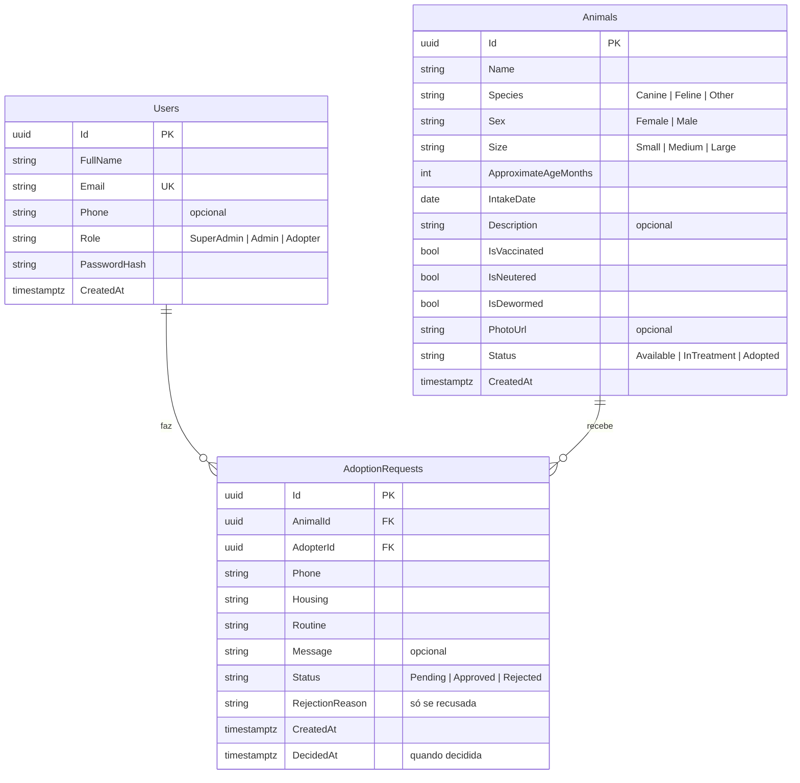
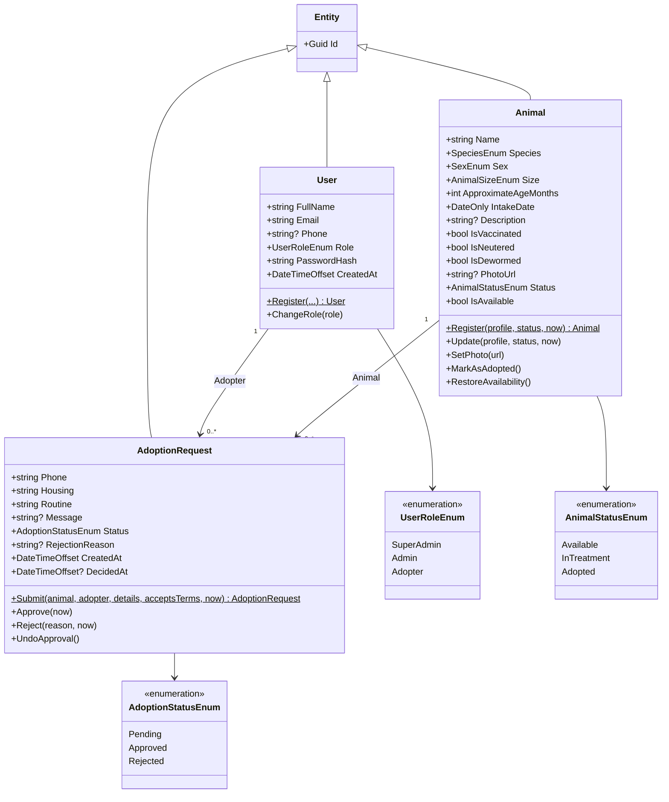
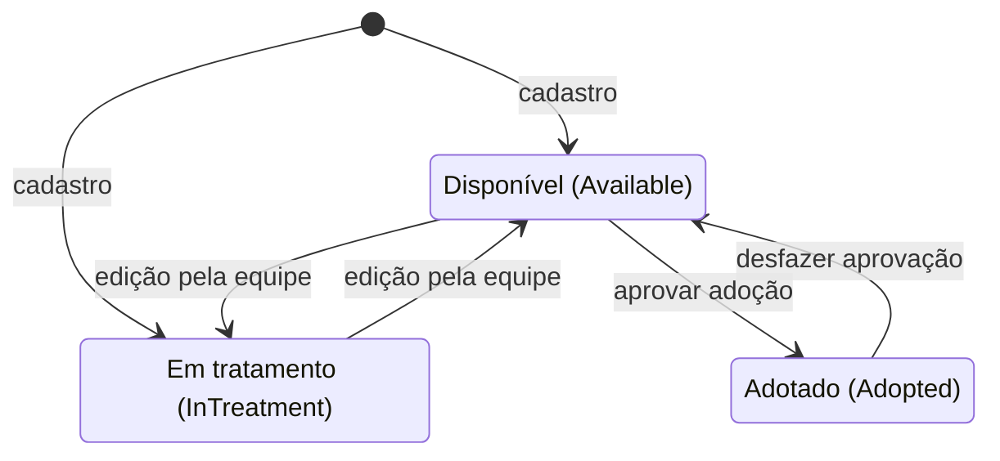
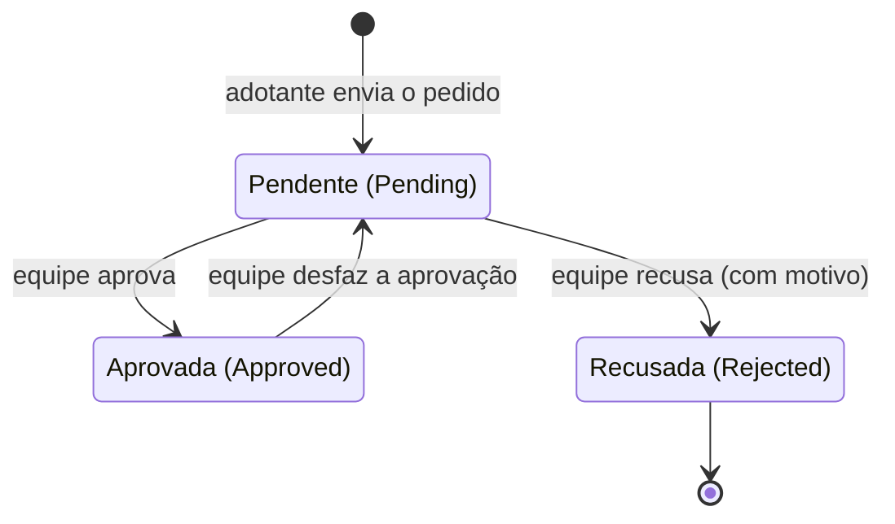
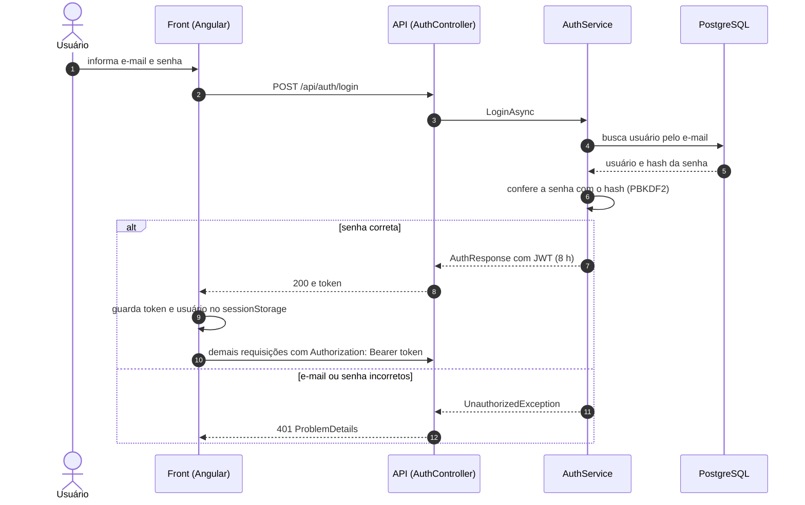
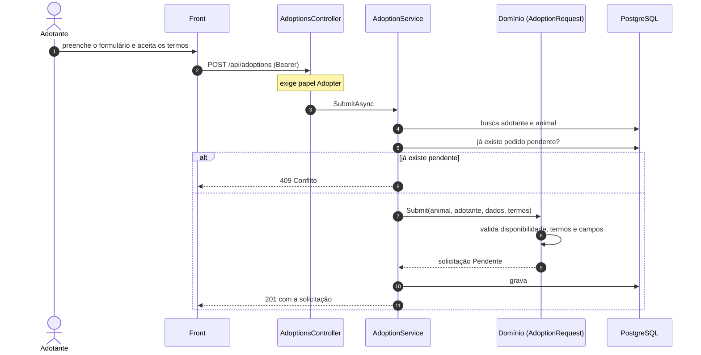
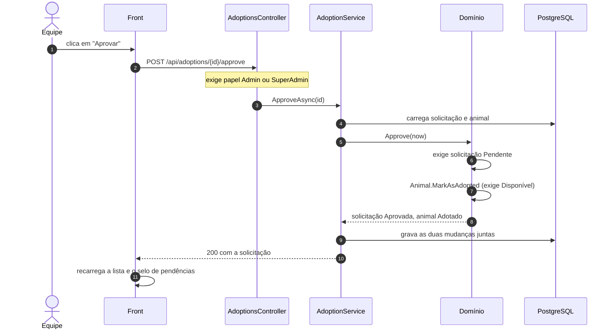
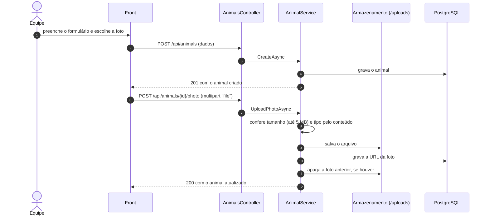

# 4. Modelagem

Os diagramas abaixo refletem o código (`ampara-api/src/Ampara/Domain` e `Infrastructure/Persistence`).

## 4.1. Modelo de dados (banco PostgreSQL)

São **três tabelas**. Os valores enumerados (papel, espécie, situação…) são gravados como **texto**, para ficarem legíveis direto no banco. As chaves são `uuid`.

**Observações**

- Não há tabelas de saúde, financeiro, voluntários ou ONGs. Esses módulos estão no [roadmap](08-demo-limitacoes-e-roadmap.md#4-roadmap).
- O banco é criado e atualizado por **migration** do EF Core (`InitialCreate`). Em desenvolvimento, o sistema aplica a migration e insere dados de demonstração ao iniciar.

## 4.2. Modelo de domínio (classes)

As entidades têm **setters privados** e **métodos de fábrica**. Elas não podem ficar em estado inválido: toda regra de negócio lança `DomainException` quando violada.

## 4.3. Máquinas de estado

### Animal

A situação **Adotado** só é alcançada por uma aprovação de adoção e só é desfeita ao desfazer essa aprovação. A edição manual alterna apenas entre *Disponível* e *Em tratamento* (RN-07).

> Um animal *Em tratamento* **não** pode ser adotado: ele precisa voltar a *Disponível* antes (`Animal.MarkAsAdopted`).

### Solicitação de adoção

> Uma solicitação *Recusada* é final. O adotante pode enviar um **novo** pedido pelo mesmo animal, pois a regra de duplicidade (RN-11) só considera pedidos em análise.

## 4.4. Diagramas de sequência

### Login e uso do token

### Solicitar adoção

### Aprovar adoção

### Cadastro de animal com foto

