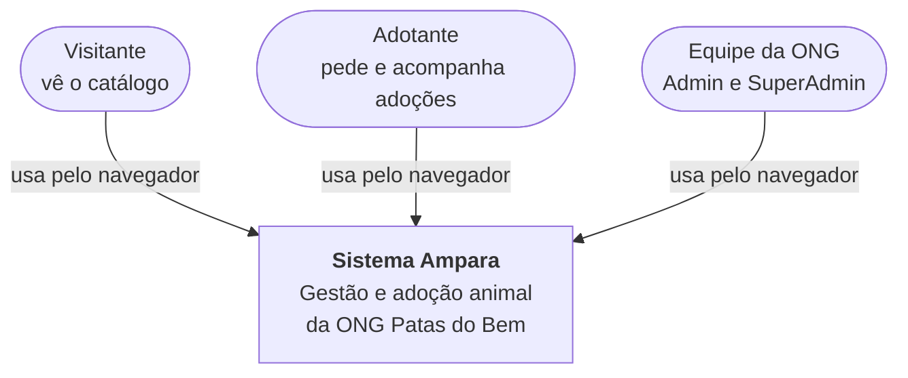
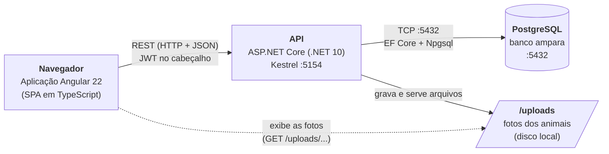
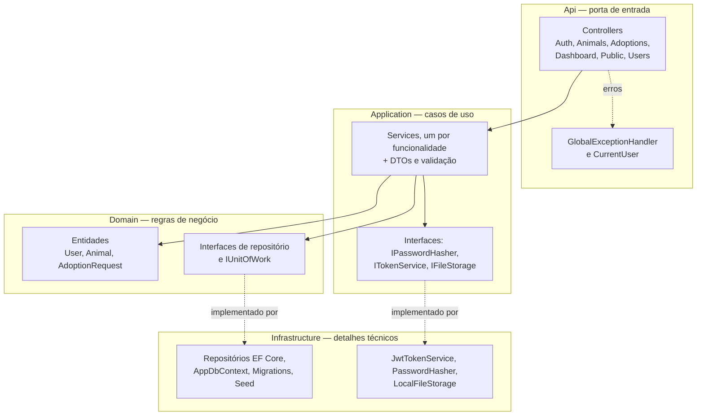
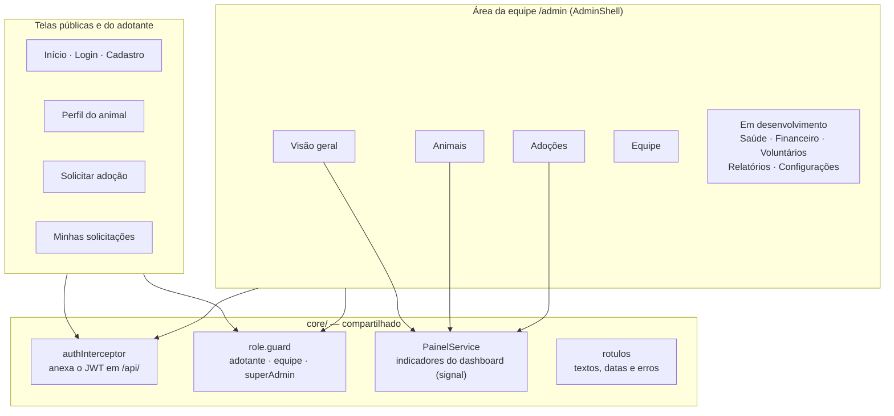
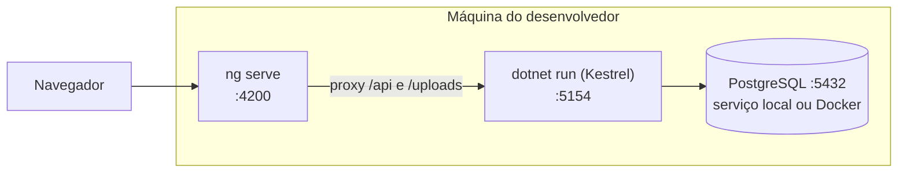

# 5. Arquitetura e decisões

A arquitetura é descrita em níveis, do mais geral ao mais detalhado, seguindo o modelo **C4** (contexto, contêineres, componentes).

## 5.1. Nível 1 — Contexto

Quem usa o sistema e com o que ele se relaciona.

O Ampara **não** se integra a nenhum sistema externo.

## 5.2. Nível 2 — Contêineres

As partes que são executadas e como se comunicam.

| Contêiner | Tecnologia | Responsabilidade |
|---|---|---|
| **Aplicação web** | Angular 22, TypeScript, CSS | Telas públicas, área do adotante e painel da equipe. Chama a API. |
| **API** | ASP.NET Core, EF Core 10 | Regras de negócio, autenticação, autorização, persistência e arquivos. |
| **Banco** | PostgreSQL 16+ | Guarda usuários, animais e solicitações. |
| **Arquivos** | Pasta `uploads/` | Guarda as fotos enviadas. |

**Em desenvolvimento**, o servidor do Angular (`ng serve`, porta 4200) usa um *proxy* (`proxy.conf.json`) que encaminha `/api` e `/uploads` para a API na porta 5154. Assim o navegador fala sempre com a mesma origem. A API também libera o CORS de `http://localhost:4200`.

## 5.3. Nível 3 — Componentes da API

O back-end é um **monolito em camadas** (*Clean Architecture* com DDD simplificado). A regra é que **as dependências apontam para dentro**: as camadas externas conhecem as internas, e nunca o contrário.

| Camada | Pasta | O que contém | Depende de |
|---|---|---|---|
| **Domain** | `Domain/` | Entidades com as regras (`Animal.MarkAsAdopted`, `AdoptionRequest.Approve`…), enums e contratos de repositório | Nada |
| **Application** | `Application/` | Um *service* por funcionalidade e os DTOs; orquestra repositórios e domínio | Domain |
| **Infrastructure** | `Infrastructure/` | EF Core/PostgreSQL, migration e seed, JWT, hash de senha, armazenamento de fotos | Application, Domain |
| **Api** | `Api/` | Controllers finos, tratamento de erros, usuário atual | Application |

**Por que assim?** As regras de negócio ficam no domínio, sem depender de banco, de HTTP ou de framework. Por isso os testes unitários rodam sem banco de dados e em poucos segundos.

## 5.4. Nível 3 — Componentes do front-end

| Aspecto | Escolha |
|---|---|
| Componentes | *Standalone* (sem NgModules), carregados sob demanda (*lazy loading*) |
| Estado | *Signals* do Angular; sem biblioteca de estado externa |
| Formulários | *Template-driven* (`ngModel`) |
| Navegação | Angular Router, com guards funcionais (`CanActivateFn`) |
| HTTP | `HttpClient` com um interceptor que anexa o token |
| Sessão | `sessionStorage` (token, usuário e expiração) |
| Estilo | Variáveis CSS globais (`tokens.css`) + `base.css`, `admin.css` e CSS por componente |

Mapa de rotas:

| Rota | Tela | Acesso |
|---|---|---|
| `/` | Início | Público |
| `/entrar`, `/registrar` | Login e cadastro | Público |
| `/animais/:id` | Perfil do animal | Público |
| `/animais/:id/adotar` | Solicitar adoção | Adotante |
| `/minhas-solicitacoes` | Minhas solicitações | Adotante |
| `/admin/visao-geral` | Painel | Equipe |
| `/admin/animais` | Lista e cadastro de animais | Equipe |
| `/admin/adocoes` | Análise de solicitações | Equipe |
| `/admin/equipe` | Gestão da equipe | SuperAdmin |
| `/admin/saude`, `/financeiro`, `/voluntarios`, `/relatorios`, `/configuracoes` | "Em desenvolvimento" | Equipe |

> Os guards do front só melhoram a experiência (redirecionam). **A segurança de verdade está na API** (veja [6. API e segurança](06-api-e-seguranca.md)).

## 5.5. Implantação

Hoje o sistema roda **localmente**:

O quadro do Trello prevê, como evolução, a API em um serviço gerenciado de nuvem, o PostgreSQL gerenciado e o front estático com HTTPS (cartão *Deploy*, ainda pendente).

## 5.6. Decisões de arquitetura

Registro curto (ADR) das principais escolhas.

### ADR-01 — Monolito em camadas, e não microsserviços
- **Contexto:** equipe de 6 pessoas, escopo acadêmico, prazo curto.
- **Decisão:** um único projeto ASP.NET Core, organizado em pastas `Domain/Application/Infrastructure/Api`.
- **Consequências:** implantação e depuração simples. Se um módulo crescer (ex.: financeiro), as camadas já deixam claro onde separar.

### ADR-02 — Regras de negócio no domínio
- **Decisão:** as entidades protegem os próprios invariantes (setters privados, métodos de fábrica, `DomainException`).
- **Consequências:** impossível criar um animal "Adotado" ou aprovar duas vezes por engano, independentemente de quem chame. Testável sem banco.

### ADR-03 — PostgreSQL com EF Core e migrations
- **Decisão:** banco relacional PostgreSQL, acesso por EF Core 10 (Npgsql) e esquema versionado em migrations.
- **Consequências:** consultas parametrizadas (protege de SQL injection) e esquema reproduzível em qualquer máquina. Enums gravados como texto facilitam a leitura direta no banco.

### ADR-04 — Autenticação por JWT
- **Decisão:** token JWT de 8 horas, assinado com chave simétrica; o papel vai dentro do token.
- **Consequências:** API sem sessão no servidor (*stateless*). Em contrapartida, não há renovação do token nem revogação antes do vencimento (ver [limitações](08-demo-limitacoes-e-roadmap.md#3-limitações-conhecidas)).

### ADR-05 — Hash de senha com PBKDF2 do ASP.NET Core
- **Decisão:** usar o `PasswordHasher` do ASP.NET Core (PBKDF2 com sal), sem adotar o ASP.NET Identity completo.
- **Consequências:** algoritmo padrão e confiável, sem as tabelas extras do Identity (o sistema só precisa de três).

### ADR-06 — Erros padronizados (ProblemDetails)
- **Decisão:** um `GlobalExceptionHandler` converte exceções em respostas RFC 7807 (422 regra de negócio, 404, 401, 409; o resto vira 500 genérico).
- **Consequências:** o front mostra o campo `detail` ao usuário sem tratar cada caso; erros internos nunca vazam.

### ADR-07 — Estado do front com Signals, sem biblioteca de estado
- **Decisão:** usar *signals* nativos do Angular e um serviço compartilhado (`PainelService`) apenas onde há dado dividido entre telas.
- **Consequências:** menos código e nenhuma dependência extra. Se o sistema crescer muito, vale reavaliar.

### ADR-08 — Segredos fora do repositório
- **Decisão:** chave JWT, senha do banco e senha de demonstração ficam no `dotnet user-secrets` (desenvolvimento). A API se recusa a iniciar sem uma chave com 32 caracteres ou mais.
- **Consequências:** nenhum segredo vai para o Git. Quem clona o projeto precisa configurar os segredos (passo a passo no README).

### ADR-09 — SignalR para tempo real *(planejada, ainda não implementada)*
- **Decisão prevista:** um *hub* no próprio monolito, autenticado por JWT, com um grupo por ONG, para avisar a equipe de novos pedidos.
- **Detalhes:** ver [roadmap](08-demo-limitacoes-e-roadmap.md#4-roadmap).
