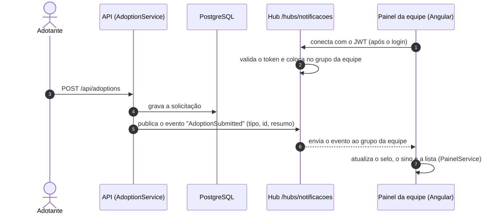

# 8. Demo, limitações e roadmap

## 1. Roteiro de demonstração

Duração sugerida: **10 a 12 minutos**. Preparação (antes de apresentar): banco, API e front no ar; duas janelas do navegador, uma logada como adotante e outra como admin (ou uma janela anônima).

| # | Tempo | O que mostrar | Perfil | O que dizer |
|---|---|---|---|---|
| 1 | 1 min | Página inicial e a ficha de um animal | Visitante | O catálogo é público e mostra só animais disponíveis |
| 2 | 1 min | Cadastro de uma conta nova | Visitante | Todo cadastro entra como Adotante; a senha é guardada como hash |
| 3 | 2 min | Pedir adoção de um animal | Adotante | Termos obrigatórios; um segundo pedido do mesmo animal é barrado (409) |
| 4 | 1 min | "Minhas solicitações" | Adotante | O adotante só enxerga os próprios pedidos |
| 5 | 1 min | Tentar abrir `/admin/visao-geral` | Adotante | O guard redireciona; a API também responderia 403 |
| 6 | 2 min | Visão geral: indicadores e gráfico | Admin | Dados reais, calculados pela API a partir do banco |
| 7 | 2 min | Cadastrar um animal com foto | Admin | Validações no formulário e no domínio; a situação "Adotado" não pode ser editada à mão |
| 8 | 2 min | Aprovar o pedido; mostrar o animal sumindo do catálogo | Admin | Aprovar muda o pedido e o animal em uma única gravação |
| 9 | 1 min | Desfazer a aprovação | Admin | O animal volta a ficar disponível |
| 10 | 1 min | Gestão da equipe | SuperAdmin | Só o SuperAdmin promove; o papel dele é imutável |
| 11 | 1 min | Menu: Saúde, Financeiro, Voluntários… | Admin | Áreas planejadas, identificadas como "Em desenvolvimento" |

> **Atenção:** o cartão do Trello pede uma demo "com notificação ao vivo". Isso depende do SignalR, que **ainda não existe**. Na demo atual, o admin vê o novo pedido ao recarregar a tela (botão *Atualizar*). Veja a [seção 4](#4-roadmap).

**Contas de demonstração** (senha definida em `Seed:DemoPassword`, veja o README): `admin@ampara.local` e `adotante@ampara.local`.

## 2. Alinhamento entre o código e o quadro do Trello

O quadro foi conferido com o repositório `sistema-dac-back` (branch `main`) e com as alterações locais ainda não enviadas, e **alinhado ao código em 24/11/2026**. O critério foi: desmarcar o que não existe, corrigir o texto do que existe de outra forma e criar cartões para o que está no código e não estava no quadro. Nada foi apagado.

### 2.1. Cartões ajustados

| Cartão | Ajuste feito no quadro |
|---|---|
| Isolar dados por ONG e tela Configurações | Itens desmarcados (0/2): o sistema atende uma só ONG e *Configurações* é página "Em desenvolvimento" |
| Saúde e cuidados | Itens desmarcados (0/2): só existem três indicadores no animal (vacinado, castrado, vermifugado) |
| Voluntários | Item desmarcado (0/1): não existe |
| Ficha do animal | Itens desmarcados (0/2): a ficha pública mostra dados e foto, sem histórico |
| Cadastro e edição de animal | "Wizard com validação por passo" virou "Formulário com validação"; descrição corrigida |
| Login com JWT e papéis | "Token renovado pelo interceptor" virou "Interceptor anexa o token…"; criado o item pendente "Renovação do token"; descrição corrigida (JWT de 8 horas, sem refresh, papéis SuperAdmin, Admin e Adopter) |
| Lista de animais | KPI "em adaptação" virou "adotados" |
| Fluxo de adoção no back | Descrição com os estados reais (pendente, aprovada, recusada); criado o item pendente "Estados recebida, em análise e concluída" |
| Testes | Item "evento entregue só à ONG certa" desmarcado; descrição com os 64 testes unitários |
| Documentação e apresentação | "Demo ensaiada" desmarcado (a demo ao vivo depende do SignalR); itens novos para a pasta `docs/` e para o envio ao GitHub |
| Criar repositórios | Descrição com os repositórios reais |
| Criar workspace Angular | Descrição e item corrigidos: é um único app Angular |
| Criar monolito ASP.NET Core | Item do seed corrigido (SuperAdmin, adotante e animais de demonstração) |

### 2.2. Itens que já estavam corretos (ainda não feitos)

Desmarcados no Trello e inexistentes no código:

- **SignalR** (5 cartões), incluindo "Pedido aparece no painel na hora" e "Indicadores atualizam em tempo real".
- **Termo, entrega e conclusão** ("PDF do termo gerado" e "Entrega registrada atualiza o animal").
- Recuperar senha e verificar e-mail, CI no GitHub Actions (adiado), financeiro, relatórios, voluntariado/doação/institucionais e deploy.

### 2.3. Cartões criados

| Cartão | Lista | Situação |
|---|---|---|
| Gestão da equipe (promover e rebaixar) | Autenticação e ONG | 3/3 |
| Minhas solicitações do adotante | Adoções | 2/2 |
| Desfazer aprovação de adoção | Adoções | 2/3 (falta o teste automatizado) |

### 2.4. Pendências de repositório

| Situação | Detalhe | Providência |
|---|---|---|
| O repositório `Sistema-dac-front` está **vazio** | Todo o código (API e front) está em `sistema-dac-back`, com as pastas `ampara-api` e `ampara-front` | Decidir: usar o repositório único e remover o vazio, ou separar de fato |
| As telas da equipe e os guards **não foram enviados** | Menu compartilhado, Visão geral, Animais, Equipe, guards por papel, `admin.css` e a pasta `docs/` existem só na máquina local | Fazer *commit* e *pull request* (a pasta local não é um repositório Git; é preciso clonar e copiar, ou iniciar o Git) |
| Os títulos de dois cartões de Setup citam `ampara-api` e `ampara-web` | Os nomes reais são `sistema-dac-back` e `Sistema-dac-front` | Renomear os cartões |

## 3. Limitações conhecidas

| # | Limitação | Impacto | Como resolver |
|---|---|---|---|
| L-01 | A tela de **Adoções** pede 100 itens por página, mas a API limita a 50 | Com mais de 50 solicitações, só as 50 primeiras aparecem | Paginar a tela, ou subir o limite da API |
| L-02 | Sem **tempo real**: o painel só atualiza ao carregar ou clicar em *Atualizar* | O admin não é avisado de novos pedidos | Implementar o SignalR (seção 4) |
| L-03 | Token **JWT** de 8 horas sem renovação nem revogação | Sessão expira de repente; token roubado vale até vencer | *Refresh token* e cookie `httpOnly` |
| L-04 | Sem limite de tentativas de login | Vulnerável a força bruta | *Rate limiting* e bloqueio temporário |
| L-05 | Sistema de **uma ONG** | Não atende várias organizações | Entidade `Organization` e filtro por organização |
| L-06 | **Fotos em disco local** | Perdem-se se o servidor for recriado; não escala | Armazenamento em nuvem (Blob/S3) |
| L-07 | Sem **testes de integração** nem do front | Regressões de rota e de tela passam despercebidas | Ver [7. Testes](07-testes.md#74-lacunas-conhecidas) |
| L-08 | Sem **integração contínua** | Nada roda os testes automaticamente a cada PR | GitHub Actions (cartão já existe) |
| L-09 | Sem **deploy** público | Só roda localmente | Cartão *Deploy* |
| L-10 | A busca por nome usa `ILIKE` do PostgreSQL, que não ignora acentos (comportamento padrão) | "Joao" não encontra "João" | Extensão `unaccent` |
| L-11 | O cadastro de animal não tem **exclusão** | Animal cadastrado por engano só pode ser editado | Exclusão lógica (arquivar) |
| L-12 | A busca por trecho (`%termo%`) não usa índice | Em volumes grandes pode ficar lento | Índice *trigram* ou busca de texto completo |

## 4. Roadmap

Ordem sugerida, da maior para a menor prioridade.

| Prioridade | Entrega | Cartões do Trello | Observação |
|:---:|---|---|---|
| 1 | **Sincronizar** repositórios e quadro (seção 2) | — | Pré-requisito para tudo o mais |
| 2 | **Notificações em tempo real (SignalR)** | Tempo real (5 cartões) | Maior diferencial; combina com a demo |
| 3 | Testes de integração, de `UndoApproval` e dos guards do front | Testes | Fecha lacunas de qualidade |
| 4 | Estados da adoção, **termo em PDF** e registro da entrega | Fluxo de adoção · Termo, entrega e conclusão | Completa o ciclo da adoção |
| 5 | **Saúde e cuidados** | Saúde e cuidados | Nova tabela de atendimentos |
| 6 | CI no GitHub Actions e **deploy** | CI · Deploy | Ambiente público para a demo |
| 7 | Recuperar senha e verificar e-mail | Recuperar senha… | Exige serviço de e-mail |
| 8 | Voluntários, financeiro e relatórios | Gestão | Desejáveis |
| 9 | Portal: voluntariado, PIX e institucionais | Portal | Desejável |
| 10 | Multi-ONG e configurações | Isolar dados por ONG | Mudança estrutural (alto impacto) |

### 4.1. Proposta técnica para o SignalR (RF-22)

**Objetivo:** quando um adotante envia um pedido, a equipe que está com o painel aberto é avisada na hora, sem recarregar.

| Parte | Mudança |
|---|---|
| **API** | `AddSignalR()` e `MapHub<NotificationsHub>("/hubs/notificacoes")`, com `[Authorize(Roles = Staff)]`. O JWT vai na *query string* (`access_token`), pois o WebSocket não envia cabeçalho `Authorization` |
| **Eventos** | Publicados **depois** de gravar no banco: nova solicitação, mudança de status, novo animal. Carga pequena: `{ tipo, id, resumo }` |
| **Grupos** | Hoje um único grupo "equipe". Com multi-ONG, um grupo por organização |
| **Front** | Pacote `@microsoft/signalr`; conexão no `PainelService` (já alimenta o selo e o sino); reconexão automática; indicador de conexão no topo |
| **Dev** | Proxy do `ng serve` com `ws: true` para `/hubs` |
| **Testes** | Evento entregue só a quem tem papel de equipe; conexão recusada sem token válido |
| **Contingência** | O SignalR usa *long polling* se o WebSocket falhar |

**Mapeamento com os cartões:** *Configurar hub* → API; *Publicar eventos* → serviços; *Conectar o painel ao hub* e *Indicador de conexão* → front; *Central de notificações* → sino do topo, que hoje já mostra o total de pendências e passaria a listar os eventos.
